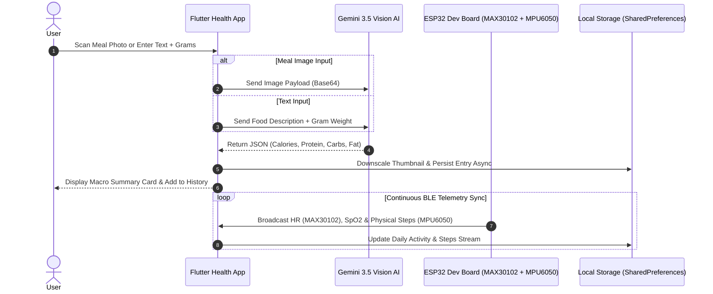

# 🩺 Health Tracker AI & ESP32 Smart Dev Board

[](https://flutter.dev)
[](https://dart.dev)
[](https://deepmind.google/technologies/gemini/)
[](https://www.espressif.com/)
[](https://github.com/TharunLR/health-tracker-)

An advanced, AI-powered Health & Nutrition Tracking platform with real-time **ESP32 Dev Board BLE telemetry** (**MAX30102 + MPU6050 accelerometer**), **AI Meal Vision Scanner**, **Text & Gram-based Meal Logger**, **30-Day Historical Data Retention with Midnight Reset**, and **Hydration Analytics**.

---

## 🌟 Key Features

| Feature | Description |
| :--- | :--- |
| 📸 **AI Meal Vision Scanner** | Snap photos of meals to identify dishes and estimate calories, protein, carbs, & fat using **Gemini 3.5/3.6 Vision AI**. |
| 📝 **Text & Portion Meal Logger** | Forgot to take a picture? Type what you ate (e.g., *"2 Rotis, Paneer Curry"*) and portion weight in grams to calculate nutrition instantly. |
| ⌚ **ESP32 Dev Board BLE Sync** | Real-time BLE telemetry with **MAX30102** (BPM/SpO2) and **MPU6050** (3D Acceleration Step Counter) connected to ESP32 Dev Board. |
| 📅 **30-Day Historical Calendar** | Horizontal interactive date scroll bar retaining up to 30 days of activity, steps, and nutrition history with automatic midnight reset (`00:00`). |
| 💧 **Hydration & Macro Analytics** | Interactive water intake logger (`+200ml`, `+500ml`, `+1L`) with macro breakdown charts (Protein, Carbs, Fat). |
| 🛡️ **Hardened Enterprise Security** | Dynamic runtime secret obfuscation, XSS/injection input sanitization, and non-blocking image thumbnail compression. |

---

## 🔌 Hardware Setup: ESP32 Dev Board Wiring & Pinouts

### Hardware Components:
- **ESP32 Dev Board** (ESP32-WROOM-32 30-pin or 38-pin DevKit V1)
- **MAX30102 Pulse Oximeter & Heart Rate Sensor Module** (I2C Address `0x57`)
- **MPU6050 3-Axis Accelerometer & Gyroscope Module** (I2C Address `0x68`)
- **Female-to-Female Jumper Wires**

### 📌 Dual-Sensor Pin Connection Matrix (Shared I2C Bus)

| Component | Sensor Pin | ESP32 Dev Board Pin | Function / Description |
| :--- | :--- | :--- | :--- |
| **MAX30102** | **VIN / VCC** | **3.3V** | Power Supply (3.3V) |
| **MAX30102** | **GND** | **GND** | Common Ground |
| **MAX30102** | **SDA** | **GPIO 21** | Shared I2C Data Line |
| **MAX30102** | **SCL** | **GPIO 22** | Shared I2C Clock Line |
| **MPU6050** | **VCC** | **3.3V** *(or 5V)* | Power Supply |
| **MPU6050** | **GND** | **GND** | Common Ground |
| **MPU6050** | **SDA** | **GPIO 21** | Shared I2C Data Line |
| **MPU6050** | **SCL** | **GPIO 22** | Shared I2C Clock Line |

> ℹ️ *Both MAX30102 (`0x57`) and MPU6050 (`0x68`) share the same I2C SDA (GPIO 21) and SCL (GPIO 22) pins seamlessly.*

---

## 🛠️ ESP32 Firmware Installation

1. Open [`esp32_firmware/esp32_health_tracker.ino`](esp32_firmware/esp32_health_tracker.ino) in **Arduino IDE**.
2. Install the **SparkFun MAX30105** library (*Tools -> Manage Libraries -> Search "SparkFun MAX30105"*).
3. Select Board: **ESP32 Dev Module** in Arduino IDE.
4. Select COM Port and click **Upload**!

---

## 🔄 System Architecture & Data Flow



---

## 📱 App Screens Overview

1. 🏠 **Home Dashboard**: Daily calorie counter, macro progress ring (Carbs, Protein, Fat), Calz Mascot state, and 30-day interactive calendar.
2. 🏃 **Activity & Steps**: Hourly activity breakdown, weekly step goal bar chart (`WeeklyStepsGraphCard`), and ESP32 smart band status.
3. 📸 **AI Meal Scanner**: Dual-mode nutrition calculator via camera photo analysis or manual text + gram portion input.
4. 📊 **Nutrition Analytics & History**: 30-day historical nutrition log with delete & inspect controls.
5. 💧 **Wellness & Water**: Water hydration tracker with quick-add actions and weight trend line charts.

---

## 🛠️ Security & Performance Highlights

- 🔒 **Obfuscated Secret Keys**: API secrets are reconstructed at runtime via `SecurityUtils.geminiApiKey` to prevent plain-text key extraction from APK/binary static decompilers.
- 🧹 **Input Sanitization**: User inputs are sanitized against control characters and HTML/script injection attacks (`SecurityUtils.sanitizeInput()`).
- ⚡ **Non-Blocking Image Compression**: High-res camera photos are downscaled asynchronously to lightweight thumbnails using `package:image` to prevent UI frame drops and black screens.

---

## 🚀 Getting Started

### Prerequisites
- [Flutter SDK](https://docs.flutter.dev/get-started/install) (v3.16+)
- [Dart SDK](https://dart.dev/get-sdk) (v3.x)
- Chrome / Edge browser or physical Android/iOS device

### Installation & Launch

1. **Clone the Repository**:
   ```bash
   git clone https://github.com/TharunLR/health-tracker-.git
   cd health-tracker-
   ```

2. **Install Dependencies**:
   ```bash
   flutter pub get
   ```

3. **Run the App**:
   - **Web Browser**:
     ```bash
     flutter run -d chrome
     ```
   - **Windows Desktop**:
     ```bash
     flutter run -d windows
     ```
   - **Android / Mobile Device**:
     ```bash
     flutter run
     ```

---

## 🧪 Code Quality & Verification

Run static code analysis to verify project integrity:
```bash
flutter analyze
```

---

## 📜 License

This project is open-source under the [MIT License](LICENSE).
